<p align="center">
  
</p>

<p align="center">
  <a href="https://github.com/ishandutta2007/Awesome-Awesome-Awesome"></a><a href="https://discord.gg/jc4xtF58Ve"></a>
  <a href="https://github.com/ishandutta2007/Awesome-Chatbot/stargazers"></a>
  <a href="https://github.com/ishandutta2007/Awesome-Chatbot/network/members"></a>
  <a href="https://github.com/ishandutta2007/Awesome-Chatbot/blob/main/LICENSE"></a>
  <a href="https://github.com/ishandutta2007/Awesome-Chatbot/pulls"></a>
  <a href="https://github.com/ishandutta2007"></a>
</p>

# 🤖 Awesome Chatbot: The Definitive Conversational AI Directory

> 🌐 A meticulously curated collection of leading **Conversational AI platforms**, **AI customer service chatbots**, **autonomous agent orchestrators**, and **open-source dialog frameworks**. Whether you are architecting an enterprise support desk or deploying private LLM agents on local infrastructure, find verified pricing, tier quotas, company scales, and GitHub community metrics below. 🚀

---

## 📑 Table of Contents
- [📊 Sector Overview & Market Dynamics](#-sector-overview--market-dynamics)
- [💼 Top SaaS Chatbot & Conversational AI Platforms](#-top-saas-chatbot--conversational-ai-platforms)
- [🔓 Top Open-Source Chatbot & Conversational AI Frameworks](#-top-open-source-chatbot--conversational-ai-frameworks)
- [💡 How to Choose: SaaS vs. Open-Source](#-how-to-choose-saas-vs-open-source)
- [🤝 Contributing](#-contributing)
- [💖 Support](#-support)
- [⭐ Star History](#-star-history)
- [📜 License](#-license)

---

## 📊 Sector Overview & Market Dynamics

The global **conversational AI and chatbot market** is projected to grow from **$11.8B in 2026 to over $41.4B by 2030**, advancing at a blistering compound annual growth rate (**CAGR of 23.7%–25.3%**).

Market dynamics reflect a **moderately fragmented yet rapidly consolidating landscape** rather than a strict winner-take-all monopoly: while incumbent CRM and helpdesk titans (*Zendesk*, *Salesforce/Intercom*) anchor standard customer support workflows, specialized generative AI agent platforms (*Ada*, *Kore.ai*) and nimble SME-focused providers (*Tidio*, *Chatbase*) aggressively capture distinct market tiers across enterprise omnichannel orchestration and self-serve website automation.

---

## 💼 Top SaaS Chatbot & Conversational AI Platforms

The table below catalogs leading commercial chatbot vendors, sorted in descending order by **Company Size (Valuation / Revenue Scale)**.

| 🏢 Product / Platform | 💰 Starting Tier Pricing | 🎁 Free Tier / Free Trial Limits | 📈 Company Scale (Valuation / ARR) | 🎯 Best Use Case |
| :--- | :--- | :--- | :--- | :--- |
| **[Zendesk AI](https://www.zendesk.com/)** | **$55/agent/month** (Suite Team billed annually, or $69/mo month-to-month) | **14-day free trial** (Full Suite access, no credit card required; up to 6 months for eligible early-stage startups) | **$10.2B valuation** (Acquired by Hellman & Friedman / Permira; ~$1.7B+ ARR) | Omnichannel enterprise customer service, ticketing, and AI copilot workflows. |
| **[Intercom (Fin AI)](https://www.intercom.com/)** | **$29/seat/month** (Essential annual billing) + **$0.99 per Fin AI resolution** | **14-day free trial** (Full platform access + Fin AI testing tokens, no credit card required) | **$3.6B acquisition valuation** (Acquired by Salesforce in 2026; ~$420M ARR) | Product-led customer success, automated self-serve resolution, and in-app proactive chat. |
| **[Ada](https://www.ada.cx/)** | **$33,000/year base contract** (~$2,750/month entry; typical usage $1.00–$3.50/automated conversation) | **No perpetual free tier**; custom **14-day guided proof-of-concept trial** with capped resolution credits upon enterprise qualification | **$1.2B valuation** (Series C led by Spark Capital; $50M–$75M ARR) | High-volume multilingual enterprise customer service automation across voice, SMS, and messaging apps. |
| **[Kore.ai](https://kore.ai/)** | **$0.20 per 15-minute conversation session** (XO Platform; minimum enterprise entry plans from ~$2,000/month) | **Free developer sandbox** (Capped at **2,000 test sessions** and basic bot-building studio; 14-day enterprise trial) | **~$650M–$800M valuation** ($150M growth round led by FTV Capital & NVIDIA; $80M+ ARR) | Enterprise-grade conversational IVR, banking/healthcare conversational journeys, and workforce search agents. |
| **[Tidio](https://www.tidio.com/)** | **$24.17/month** (Starter tier billed annually, or $29/mo month-to-month) | **Free Forever plan** (Capped at **50 billable conversations/month**, 100 chatbot visitor reaches, and 50 Lyro AI testing replies) | **~$100M–$150M valuation** ($25M Series B; ~$15M ARR) | E-commerce storefronts (Shopify/WooCommerce), lead generation, and small business live support. |
| **[Chatbase](https://www.chatbase.co/)** | **$32/month** (Hobby plan billed annually, or $40/mo month-to-month) | **Free Forever plan** (Capped at **50 message credits/month**, 1 AI chatbot agent, and **1 MB data training limit**; auto-paused after 14 days inactivity) | **~$40M–$60M valuation** (Bootstrapped/Seed funded; estimated $5M–$10M ARR) | Instant document-trained GPT chatbots, embedding custom AI knowledge widgets on marketing websites. |

---

## 🔓 Top Open-Source Chatbot & Conversational AI Frameworks

Curated open-source repositories and LLM frameworks for building sovereign dialog systems, sorted in descending order by **GitHub Stars_Count**.

1. **[Dify](https://github.com/langgenius/dify)** [](https://github.com/langgenius/dify/stargazers)
   - 🌟 *An open-source LLM application development platform.* Orchestrates agentic workflows, conversational assistants, RAG pipelines, and model evaluation with an intuitive visual studio interface.
   - 🛠️ **Stack:** Python, TypeScript, Next.js, Celery, PostgreSQL, Redis

2. **[Open WebUI](https://github.com/open-webui/open-webui)** [](https://github.com/open-webui/open-webui/stargazers)
   - 🌟 *Extensible, self-hosted AI chat interface.* Designed for complete offline and local conversational experiences with Ollama, OpenAI-compatible APIs, RAG, Web search, and role-based access control.
   - 🛠️ **Stack:** Python, Svelte, Ollama, Docker

3. **[LangChain](https://github.com/langchain-ai/langchain)** [](https://github.com/langchain-ai/langchain/stargazers)
   - 🌟 *The premier framework for building context-aware reasoning applications and chatbots.* Connects LLMs with external data sources, memory chains, tool execution, and complex multi-agent graphs (LangGraph).
   - 🛠️ **Stack:** Python, LangSmith, LCEL

4. **[Lobe Chat](https://github.com/lobehub/lobe-chat)** [](https://github.com/lobehub/lobe-chat/stargazers)
   - 🌟 *Modern-design open-source ChatGPT/LLMs UI and agent framework.* Features speech synthesis, multimodal vision models, agent plugin market, and multi-provider AI switches.
   - 🛠️ **Stack:** TypeScript, Next.js, WebRTC, PWA

5. **[Flowise](https://github.com/FlowiseAI/Flowise)** [](https://github.com/FlowiseAI/Flowise/stargazers)
   - 🌟 *Drag & drop visual UI to build customized LLM flows.* Construct customer support bots, memory chains, vector store indexing, and interactive conversational logic without deep boilerplate code.
   - 🛠️ **Stack:** TypeScript, Node.js, LangChain.js, React

6. **[LlamaIndex](https://github.com/run-llama/llama_index)** [](https://github.com/run-llama/llama_index/stargazers)
   - 🌟 *Data framework for LLM-based knowledge agents and conversational search.* Ingests private databases, PDFs, and APIs into queryable vector indices and agentic chatbot workflows.
   - 🛠️ **Stack:** Python, TypeScript, Vector Stores

7. **[Coqui TTS](https://github.com/coqui-ai/TTS)** [](https://github.com/coqui-ai/TTS/stargazers)
   - 🌟 *Deep learning toolkit for Text-to-Speech and voice conversational agents.* Powers natural, low-latency synthetic voice responses in speech-driven conversational bots and IVR setups.
   - 🛠️ **Stack:** Python, PyTorch, CUDA

8. **[Chatwoot](https://github.com/chatwoot/chatwoot)** [](https://github.com/chatwoot/chatwoot/stargazers)
   - 🌟 *Open-source customer engagement suite and Intercom alternative.* Integrates live chat widgets, WhatsApp, Facebook, email, and connects upstream bot webhooks with human agent fallback.
   - 🛠️ **Stack:** Ruby on Rails, Vue.js, PostgreSQL, Redis

9. **[Haystack](https://github.com/deepset-ai/haystack)** [](https://github.com/deepset-ai/haystack/stargazers)
   - 🌟 *End-to-end LLM orchestration framework.* Modular pipelines for retrieval-augmented generation (RAG), conversational search agents, and production dialog systems.
   - 🛠️ **Stack:** Python, Elasticsearch, OpenSearch, PyTorch

10. **[Rasa](https://github.com/RasaHQ/rasa)** [](https://github.com/RasaHQ/rasa/stargazers)
    - 🌟 *Enterprise-grade conversational AI platform with CALM (Conversational AI with Language Models).* Combines generative LLMs with deterministic enterprise business logic and guardrails.
    - 🛠️ **Stack:** Python, TensorFlow/PyTorch, Rasa Pro

11. **[Botpress](https://github.com/botpress/botpress)** [](https://github.com/botpress/botpress/stargazers)
    - 🌟 *Developer infrastructure for next-gen chatbots powered by OpenAI and LLMs.* Features a visual flow builder, code executions, knowledge base connectors, and autonomous action loops.
    - 🛠️ **Stack:** TypeScript, Node.js, React

12. **[ChatterBot](https://github.com/gunthercox/ChatterBot)** [](https://github.com/gunthercox/ChatterBot/stargazers)
    - 🌟 *Machine-learning, conversational dialog engine.* Delivers rule-based and statistical sequence matching for language training and automated response generation.
    - 🛠️ **Stack:** Python, SQLite, spaCy

13. **[Microsoft Bot Framework SDK](https://github.com/microsoft/botframework-sdk)** [](https://github.com/microsoft/botframework-sdk/stargazers)
    - 🌟 *Comprehensive SDK for enterprise multi-channel conversational bots.* Seamlessly deploys conversational experiences across Microsoft Teams, Slack, Web, and Skype.
    - 🛠️ **Stack:** C#, TypeScript, Python, Azure Bot Service

---

## 💡 How to Choose: SaaS vs. Open-Source

```
                           ┌──────────────────────────────┐
                           │ Need Turnkey Customer Care?  │
                           └──────────────┬───────────────┘
                                          │
                         Yes ─────────────┴───────────── No
                          │                               │
             ┌────────────▼───────────┐      ┌────────────▼───────────┐
             │ Prefer Hosted SaaS     │      │ Complete Data Privacy, │
             │ & Native CRM Hand-off? │      │ Self-Hosting & Custom  │
             └────────────┬───────────┘      │ LLM Pipeline Control?  │
                          │                  └────────────┬───────────┘
               Yes ───────┴─────── No                     │
                │                  │                      ▼
      ┌─────────▼────────┐  ┌──────▼───────────┐  ┌───────▼──────────┐
      │ Zendesk /        │  │ Chatbase /       │  │ Dify / Flowise / │
      │ Intercom Fin     │  │ Tidio Starter    │  │ LangChain / Rasa │
      └──────────────────┘  └──────────────────┘  └──────────────────┘
```

- **Choose SaaS When:** You need instant deployment, native omnichannel integrations (Zendesk, Shopify, Salesforce), guaranteed SLAs, and turnkey human-in-the-loop escalation without managing cloud GPU infrastructure.
- **Choose Open-Source When:** Strict compliance (HIPAA, GDPR) mandates on-premise execution, zero data leakage into third-party LLM providers, complete pipeline customization, and cost-effective scaling without per-resolution fees.

---

## 🤝 Contributing

Contributions to **Awesome Chatbot** are always encouraged! 🌟

1. 🍴 **Fork** the repository.
2. 🌿 Create your feature branch (`git checkout -b feature/new-chatbot-entry`).
3. 📝 Add your tool with verified pricing, free tier limits, or GitHub stargazer links.
4. 💾 Commit your changes (`git commit -m "feat: add NewChatbot to directory"`).
5. 🚀 Push to the branch (`git push origin feature/new-chatbot-entry`).
6. 📬 Open a **Pull Request**.

---

## 💖 Support

A huge thank you to everyone exploring, building with, and contributing to **Awesome Chatbot**! 🙏

If you find this repository valuable, here are a few great ways to support the project:
- ⭐ **Star** this repository to help others discover it.
- 🍴 **Fork** and share it with your network or AI community.
- ☕ **Buy me a coffee**: Support ongoing maintenance, research, and curation directly via the [GitHub Sponsors Dashboard](https://github.com/sponsors/ishandutta2007).

---

##  Star History
[](https://star-history.dera.page/#ishandutta2007/Awesome-Chatbot&type=date&legend=top-left)

---

## 📜 License

This project is licensed under the **MIT License** - see the [LICENSE](LICENSE) file for full details. ⚖️
